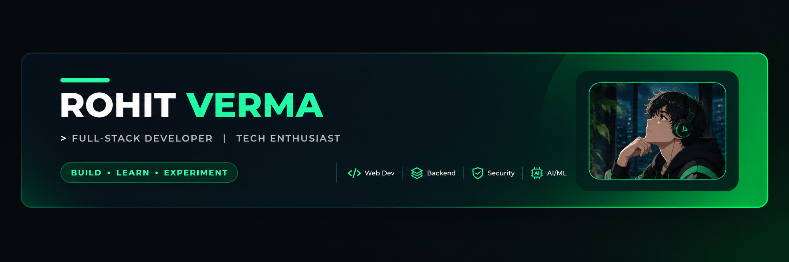
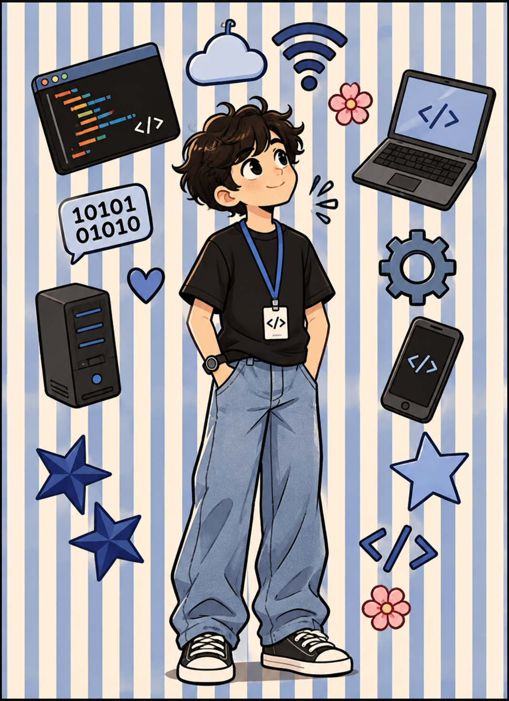

<!-- ==================== HEADER ==================== -->

 

 

  

**Building interfaces, APIs & intelligent products that solve real-world problems.**

 

---

<!-- ==================== 01 — ABOUT ME ==================== -->

# `01 — ABOUT ME`

<table>
<tr>
<td width="65%" valign="middle">

- 💻 Full Stack Developer passionate about building real-world applications.
- 🚀 Developing applications using **React, Node.js & MongoDB**.
- ⚙️ Interested in Backend Engineering, REST APIs & System Design.
- 🤖 Exploring **AI, Machine Learning & intelligent applications**.
- 🔐 Interested in Web Security and vulnerability testing.
- 🧠 Practicing Data Structures & Algorithms using Java.
- 🌱 Continuously learning, experimenting and building.
- 🎯 Focused on writing clean, scalable and maintainable code.

 

`BUILDING` · `LEARNING` · `EXPERIMENTING`

</td>
<td width="35%" align="center" valign="middle">

</td>
</tr>
</table>

---

<!-- ==================== 02 — TECH STACK ==================== -->

# `02 — THE STACK`

 

### Languages

### Frontend Development

### Backend & Databases

### Tools & Platforms

 

`REST APIs` · `JWT` · `Socket.IO` · `YOLOv8` · `MongoDB` · `MySQL`

---

<!-- ==================== 03 — SELECTED WORK ==================== -->

# `03 — SELECTED WORK`

### ✦ CIVICLENS-AI

## Civic reporting, powered by AI.

  

A full-stack civic issue reporting platform that enables citizens to report public problems through images and descriptions, with AI-assisted image analysis.

**React → Node.js → FastAPI → YOLOv8**

`Full-stack Development` · `REST APIs` · `AI Integration` · `Image Analysis`

  

---

### ✦ WEB FUZZING TOOL

## Finding what shouldn't be there.

  

A team-built web security testing platform focused on automated vulnerability scanning.

My primary contribution was backend development, including API design, scan request handling and frontend integration.

`API Design` · `Scan Processing` · `Backend Integration`

  

---

### ✦ BARTR

## Skills are currency.

  

A skill-exchange platform where students can teach, learn and connect without using money.

**Profiles · Skill Matching · Real-time Messaging · Authentication**

  

---

### ✦ NAZARA

## An e-commerce experience built from scratch.

  

A full-stack MERN e-commerce platform featuring product browsing, backend integration and shopping functionality.

---

<!-- ==================== 04 — HOW I BUILD ==================== -->

# `04 — HOW I BUILD`

 

<table>
<tr>
<td align="center" width="25%">

### `01`

**IDEA**

 

Start with a problem worth solving.

</td>
<td align="center" width="25%">

### `02`

**BUILD**

 

Turn the idea into something real.

</td>
<td align="center" width="25%">

### `03`

**BREAK**

 

Find what doesn't work.

</td>
<td align="center" width="25%">

### `04`

**IMPROVE**

 

Understand it. Fix it. Ship it.

</td>
</tr>
</table>

---

<!-- ==================== 05 — PROBLEM SOLVING ==================== -->

# `05 — PROBLEM SOLVING`

 

  

### Practicing DSA with Java

`ARRAYS` · `STRINGS` · `HASHING` · `SLIDING WINDOW`

`TWO POINTERS` · `LINKED LISTS` · `RECURSION`

`TREES` · `GRAPHS` · `DYNAMIC PROGRAMMING`

---

<!-- ==================== 06 — GITHUB ANALYTICS ==================== -->

# `06 — GITHUB ANALYTICS`

 

Code. Commit. Build. Repeat.

<table>
<tr>
<td width="50%" align="center">

</td>
<td width="50%" align="center">

</td>
</tr>
</table>

 

---

<!-- ==================== 07 — CONTRIBUTION SNAKE ==================== -->

# `07 — CONTRIBUTION SNAKE`

 

---

<!-- ==================== 08 — CURRENTLY EXPLORING ==================== -->

# `08 — CURRENTLY EXPLORING`

 

  

<table>
<tr>
<td align="center" width="25%">

### 🐳

**Docker**

 

Containerization

</td>
<td align="center" width="25%">

### ⚙️

**System Design**

 

Scalable Systems

</td>
<td align="center" width="25%">

### 🏗️

**Backend**

 

Architecture

</td>
<td align="center" width="25%">

### 🛡️

**Security & AI**

 

Intelligent Systems

</td>
</tr>
</table>

 

<h3>Learning isn't a phase. It's part of the workflow.</h3>

 

<code>BUILD</code>
&nbsp; → &nbsp;
<code>BREAK</code>
&nbsp; → &nbsp;
<code>LEARN</code>
&nbsp; → &nbsp;
<code>REBUILD</code>

---

<!-- ==================== 09 — LET'S CONNECT ==================== -->

# `09 — LET'S CONNECT`

 

If you're working on something interesting, I'd love to hear about it.

  

  

React · Node.js · APIs · Security · AI · Curiosity

  

**`Build something worth remembering.`**

 

<!--
==================== CONTRIBUTION SNAKE SETUP ====================

Create this file:
.github/workflows/snake.yml

name: Generate Contribution Snake

on:
  schedule:
    - cron: "0 0 * * *"
  workflow_dispatch:

permissions:
  contents: write

jobs:
  generate:
    runs-on: ubuntu-latest
    steps:
      - name: Generate Snake
        uses: Platane/snk@v3
        with:
          github_user_name: RohitV33
          outputs: |
            dist/github-contribution-grid-snake.svg
            dist/github-contribution-grid-snake-dark.svg?palette=github-dark

      - name: Push to output branch
        uses: crazy-max/ghaction-github-pages@v4
        with:
          target_branch: output
          build_dir: dist
        env:
          GITHUB_TOKEN: ${{ secrets.GITHUB_TOKEN }}

==================== END ====================
-->
